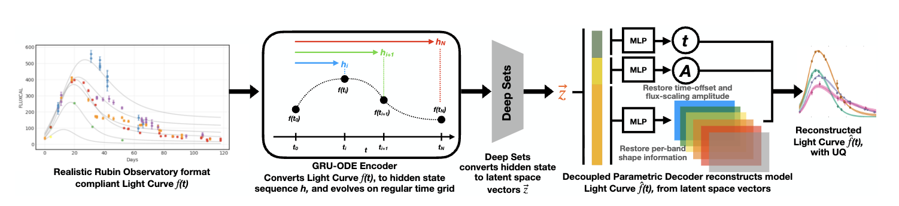

# SELDON: Supernova Explosions Learned by Deep ODE Networks



Welcome! This is the code companion to  
**“SELDON: Supernova Explosions Learned by Deep ODE Networks”**  
(Jiezhong Wu, Jack O’Brien, Jennifer Li, M. S. Krafczyk, Ved G. Shah, Amanda R. Wasserman, Daniel W. Apley, Gautham Narayan, Noelle I. Samia; to appear at AAAI 2026).

📄 **Paper:** [SELDONI.pdf](SELDONI.pdf)

We’re excited for you to explore the model—check out the architecture above, then dive into the code. SELDON blends neural ODE encoders with a band-aware decoder to reconstruct, interpolate, and forecast multi-band flux from irregular observations. Everything is Hydra-driven, with ready-to-run data loaders, models, experiments, and analysis scripts—jump in and try it!

## Features
- Neural ODE encoder for irregular, multi-band light-curve sequences with variational latent space.
- Band-aware Gaussian basis decoder for reconstruction, interpolation, and forecasting.
- Hydra-driven configuration of datasets, models, experiments, and trainer settings.
- PyTorch Lightning training with checkpointing and TensorBoard logging.
- Data loaders for pickle/parquet supernova light curves with augmentation, masking, and normalization.
- Utility scripts to load checkpoints, generate embeddings/reconstructions, and batch forecasting outputs.

## Installation

Installation is two steps. The PyTorch / Lightning / CUDA stack is provided by
a conda environment (CUDA-tagged builds have no clean PyPI equivalent), so it is
**not** declared in `pyproject.toml`. Create the conda environment first, then
install the package into it.

1. Create and activate the conda environment from `TAE/environment.yaml`
   (Python 3.12; the environment is named `tae`). You need a copy of the
   repository for this file, so clone it first:

   ```bash
   git clone https://github.com/skai-institute/seldon.git
   cd seldon
   conda env create -f TAE/environment.yaml
   conda activate tae
   ```

   For reproducible results, check out the same release tag you plan to install
   in the next step (for example `git checkout v1.2.0`) before creating the
   environment, since `TAE/environment.yaml` evolves on `main`.

1. Install the package into the activated environment. Replace `<REF>` with a
   release tag such as `v1.2.0` (recommended, reproducible) or with `main`:

   ```bash
   pip install "seldon_core @ git+https://github.com/skai-institute/seldon@<REF>"
   ```

1. Verify the package imports:

   ```bash
   python -c "import seldon_core; from seldon_core.models.factory import get_module"
   ```

   If this returns with no output, `seldon_core` is installed and importable.

See [RELEASING.md](RELEASING.md) for how release tags and versions are made.

### Installing as a library (`seldon_core`)

This repository is pip installable. The distribution and downstream import
name is `seldon_core`; inside this repository the package keeps its
historical name `TAE`. The shipped `seldon_core` package is a thin alias
that re-exports `TAE`, so both import paths resolve to the same module:

```python
import seldon_core            # same module object as `import TAE`
from seldon_core.models.factory import get_module
```

Projects that depend on `seldon_core` should pin a release tag rather than
`main`.

### Local development

For working on the code itself, clone the repository, create the `tae`
environment as above, and then either install it in editable mode:

```bash
pip install -e .
```

or skip the install and run scripts from the repository root, where
`from TAE...` imports resolve directly. Run the test suite with:

```bash
pytest -v
```

## Quickstart
### Train
Run training via Hydra. Override the dataset path and any trainer settings you need:

```bash
export OMP_NUM_THREADS=8
python train.py \
  --config-name SELDON_1.0 \
  dataset.config.lightcurve_path=/path/to/cleaned_data.pkl \
  logging_params.save_dir=./logs \
  logging_params.name=SELDON_run \
  trainer_params.devices=1 \
  trainer_params.strategy=ddp
```

`train.py` reads `OMP_NUM_THREADS` at startup and fails with a `KeyError` if it
is not set, so always export it. The `logging_params.save_dir` override is
needed because the config's default points at a cluster path. This writes
TensorBoard logs and checkpoints under `./logs/SELDON_run/version_*`.

### Inference / Forecasting
Load a trained experiment and run it on data:

```bash
python - <<'PY'
from load_model import load_model
exp = load_model("./logs/SELDON_run/version_0", device="cuda")
data_loader = exp.data.val_dataloader()
batch = next(iter(data_loader))
outputs = exp(batch)  # reconstructed flux, latents, losses
print(outputs.keys())
PY
```

Batch-generate forecasts/embeddings from checkpoints (writes safetensors outputs):

```bash
python SELDON_Data_Generator.py --config ./logs/SELDON_run/version_0
# or for forecasting streams:
python SELDON_Data_Generator_forecaster.py --config ./logs/SELDON_run/version_0
```

## Repository Structure
- `train.py` — Hydra entrypoint to launch Lightning training runs.
- `TAE/` — the core package (importable as `TAE`, or as `seldon_core` once installed).
- `TAE/configs/` — Hydra configs for datasets, models, experiments, trainer, and logging (`SELDON_1.0.yaml` is the recipe used in the Quickstart; versioned `SELDON_*.yaml` variants sit alongside it).
- `TAE/datasets/` — Data modules and preprocessing (pickle/parquet light curves, masking, augmentations).
- `TAE/models/` — Encoders/decoders, neural ODE components, losses, embeddings, and factory wiring.
- `TAE/experiments/` — Lightning experiment wrappers (GRUVAEExperiment) and factory.
- `TAE/docs/` — Walkthroughs of the ODE helper, encoder, decoder, and SELDON overview.
- `TAE/environment.yaml` — Conda environment specification (Python 3.12, PyTorch / Lightning / CUDA stack).
- `seldon_core/` — Thin alias package that re-exports `TAE` under the `seldon_core` name.
- `pyproject.toml` — Packaging metadata for the `seldon_core` distribution (pure-pip dependencies only).
- `tests/` — pytest suite (smoke, instantiation, factories, imports, configs, alias).
- `load_model.py` — Helper to load a saved experiment/checkpoint for evaluation.
- `SELDON_Data_Generator*.py` — Scripts to load checkpoints and dump reconstructions/forecasts to safetensors.
- `tools/tfm_sync/` — Maintainer tool that syncs this repository from the private development repository.
- `RELEASING.md` — How releases, tags, and versions are made.

## Running the Scripts
- Training: `python train.py --config-name SELDON_1.0 [overrides...]`
- Quick evaluation: use `load_model.py` as shown above.
- Batch output generation: `python SELDON_Data_Generator.py --config <checkpoint_dir>`; forecasting with `SELDON_Data_Generator_forecaster.py`.
- Plots (during training) are logged to TensorBoard under the run directory.

## Working on the NCSA DeltaAI Cluster

These steps build the `tae` environment on DeltaAI so it can be used in batch
jobs.

1. If necessary open your VPN connection to NCSA. Use the `2-ncsa-cilogon-tunnelall` group.

1. Log into the NCSA DeltaAI cluster:

   ```bash
   ssh dtai-login.delta.ncsa.illinois.edu
   ```

1. Verify that your `.bashrc` file does not already contain any conda or other
   module activation commands:

   ```bash
   grep -i conda ~/.bashrc
   grep -i module ~/.bashrc
   ```

   You should not see any output from these commands. If you do stop and request
   assistance.

1. Clone this repository:

   ```bash
   git clone https://github.com/skai-institute/seldon.git
   ```

1. Change to the repository directory:

   ```bash
   cd seldon
   ```

1. Check out the release tag you intend to build against, rather than staying on
   `main`. The conda environment is created from `TAE/environment.yaml`, and that
   file evolves on `main`; checking out a tag pins the environment to the exact
   dependency set shipped in that release. Use the **same tag** that you will
   install `seldon_core` at, so the environment and the installed library agree
   (replace `<TAG>` with the tag you want, for example `v1.2.0`):

   ```bash
   git checkout <TAG>
   ```

1. Load the `python/miniforge3_pytorch/2.5.0` module:

   ```bash
   module load python/miniforge3_pytorch/2.5.0
   ```

1. Run the `accounts` command to determine which accounts you have access to:

   ```bash
   accounts
   ```

1. Use the `srun` command to log into one of the DeltaAI interactive nodes. This
   is necessary so that the correct GPU and CPU types are detected. Replace
   `<ACCOUNT>` with one of the values from the output from the `accounts` command:

   ```bash
   srun --account=<ACCOUNT> --partition=ghx4-interactive \
   --nodes=1 --gpus-per-node=1 --tasks-per-node=16 --mem=200G \
   --time=02:00:00 --pty bash -i
   ```

   Wait for the interactive node to become available. It may take many minutes
   depending on the load on the cluster.

1. Once you are logged into the interactive node create the conda environment:

   ```bash
   conda env create -f TAE/environment.yaml
   ```

   This will take a few minutes to complete.

1. Run `conda init` to initialize the conda environment:

   ```bash
   conda init
   ```

   This makes changes to your `.bashrc` file so that the conda environment is
   automatically activated when you log in the next time.

1. Source the `.bashrc` file to activate the conda environment:

   ```bash
   source ~/.bashrc
   ```

   This is only necessary now so that you do not have to logout and log back in and
   start a new interactive session.

1. Activate the conda environment you just created:

   ```bash
   conda activate tae
   ```

1. Run the following python command to verify the environment:

   ```bash
   python -c "import torch; print(torch.cuda.is_available()); print(torch.ones(3, device='cuda').sum().item())"
   ```

   The output should be:

   ```bash
   True
   3.0
   ```

   If you do not see the output above, stop and request assistance.

1. Exit the interactive node session:

   ```bash
   exit
   ```

Your environment is now ready to use in batch jobs that use `seldon_core`.

### Running a `seldon_core` batch job on DeltaAI

The `tae` conda environment you built above already carries every dependency
`seldon_core` itself needs. A project that imports `seldon_core` can add its own
code and dependencies on top. The pattern is:

1. install `seldon_core` at a pinned release tag into the `tae` environment,
2. install the project's own additional dependencies,
3. submit an `sbatch` job that activates `tae` and runs on a `ghx4` (GH200) node.

The steps:

1. From a `ghx4` interactive node (see the previous section), activate the
   environment:

   ```bash
   conda activate tae
   ```

1. Install `seldon_core` at a **pinned release tag** into the environment. Pin a
   tag rather than `main` so your runs are reproducible (replace `<TAG>` with the
   tag you want, for example `v1.2.0`):

   ```bash
   pip install "seldon_core @ git+https://github.com/skai-institute/seldon@<TAG>"
   ```

1. Verify the package imports:

   ```bash
   python -c "import seldon_core; from seldon_core.models.factory import get_module"
   ```

   If this returns with no output, `seldon_core` is installed and importable.

1. Install your project's own additional dependencies, if any (for example from
   its `requirements.txt` or environment file). These land in the `tae`
   environment alongside `seldon_core`:

   ```bash
   pip install -r requirements.txt
   ```

1. Write an `sbatch` script for the job. The template below targets a `ghx4`
   (GH200) node, activates `tae`, and runs SELDON training from the repository
   root. Replace the placeholders in angle brackets:

   ```bash
   #!/usr/bin/bash
   #SBATCH --account=<ACCOUNT>-dtai-gh
   #SBATCH --partition=ghx4
   #SBATCH --nodes=1
   #SBATCH --gpus=1
   #SBATCH --ntasks-per-node=1
   #SBATCH --cpus-per-task=2
   #SBATCH --mem-per-cpu=80000
   #SBATCH --time=48:00:00
   #SBATCH --job-name=<JOB_NAME>
   #SBATCH --output=logs/%x_%A.out
   #SBATCH --error=logs/%x_%A.err
   #SBATCH --mail-type=FAIL
   #SBATCH --mail-user=<YOU>@illinois.edu

   date; hostname; pwd
   source ~/.bashrc
   source activate tae

   # train.py reads OMP_NUM_THREADS at import and fails with a KeyError if it is
   # unset, so always export it.
   export OMP_NUM_THREADS=8

   python train.py --config-name=<CONFIG> dataset.config.lightcurve_path=/projects/<ACCOUNT>/data/<DATA_FILE>
   ```

   Notes:
   - `<ACCOUNT>` is one of the accounts from the `accounts` command; the
     `-dtai-gh` suffix selects the DeltaAI GH200 allocation.
   - The `--output` / `--error` paths write into a `logs/` directory that must
     already exist. Create it once with `mkdir -p logs` in the directory you
     submit from, or the job will fail to start.
   - Keep large input data and run artifacts on `/projects/<ACCOUNT>/...`
     (durable) or `/work/nvme/<ACCOUNT>/...` (fast scratch), never in `$HOME`.

1. Submit the job from a login node (you do **not** need to be on an interactive
   node to submit):

   ```bash
   sbatch <JOB_SCRIPT>.sbatch
   ```

   Check on it with `squeue --me` and watch its output with
   `tail -f logs/<JOB_NAME>_<JOBID>.out`.

## Citation
If you use SELDON in academic work, please cite the AAAI 2026 paper:

```bibtex
@inproceedings{2026seldonI,
  title     = {SELDON: Supernova Explosions Learned by Deep ODE Networks},
  author    = {Jiezhong Wu and Jack O'Brien and Jennifer Li and M. S. Krafczyk and Ved G. Shah and Amanda R. Wasserman and Daniel W. Apley and Gautham Narayan and Noelle I. Samia},
  booktitle = {Proceedings of the AAAI Conference on Artificial Intelligence},
  year      = {2026}
}
```

## License
BSD 3-Clause License. See `LICENSE` for details.
